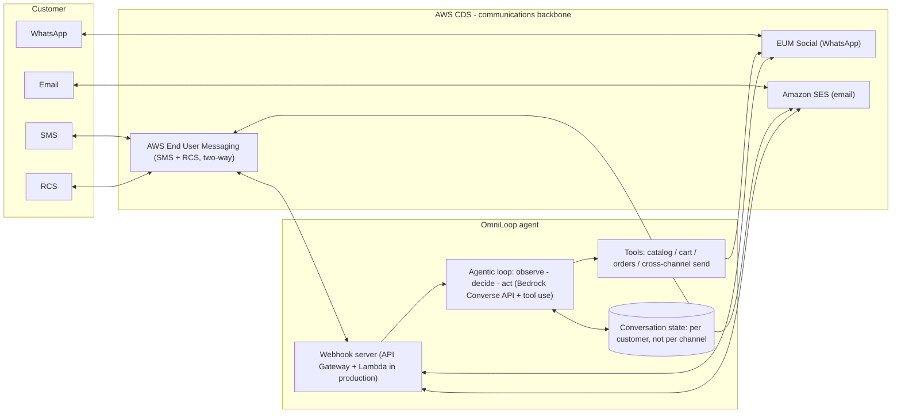

# OmniLoop — Architecture

## Design decisions

- **Conversation state keyed by customer, not channel** — every turn stores its channel; the agent prompt sees the full cross-channel history, so switching channels never loses context.
- **Channel adapters as a registry** — sms, rcs, whatsapp, email implement one ChannelAdapter interface. Mock adapters mirror the live ones for tests and offline demo, so the demo exercises the exact code path that calls AWS CDS in live mode.
- **Live adapters call real AWS SDKs at runtime** — PinpointSMSVoiceV2Client with SendTextMessageCommand and SendRcsMessageCommand, SigV4-signed EUM Social REST /v1/whatsapp/send, and SESv2Client with SendEmailCommand.
- **Model-agnostic agent loop** — BedrockModel (Converse API) in live mode, ScriptedModel for deterministic tests. No AgentCore deployment is included. The loop follows an agent pattern: observe inbound message, decide (LLM + tools), act, respond on the originating channel.
- **Production topology** — webhook server is a plain Express app here; in production it maps 1:1 to API Gateway + Lambda with DynamoDB state.

## Submission mapping (hackathon requirements)

| Requirement | Where |
|---|---|
| at least 1 AWS CDS service at runtime | EUM SMS + RCS, EUM Social WhatsApp, SES (live adapters in src/channels/) |
| Agentic AI (Bedrock AgentCore recommended) | Agent loop + Bedrock Converse API (src/agent/loop.ts, src/bedrock/model.ts) |
| Real-world customer use case | Omnichannel commerce: cross-channel continuation + order completion |
| Reproducible | npm install && npm run demo && npm test; live env vars documented in README |
