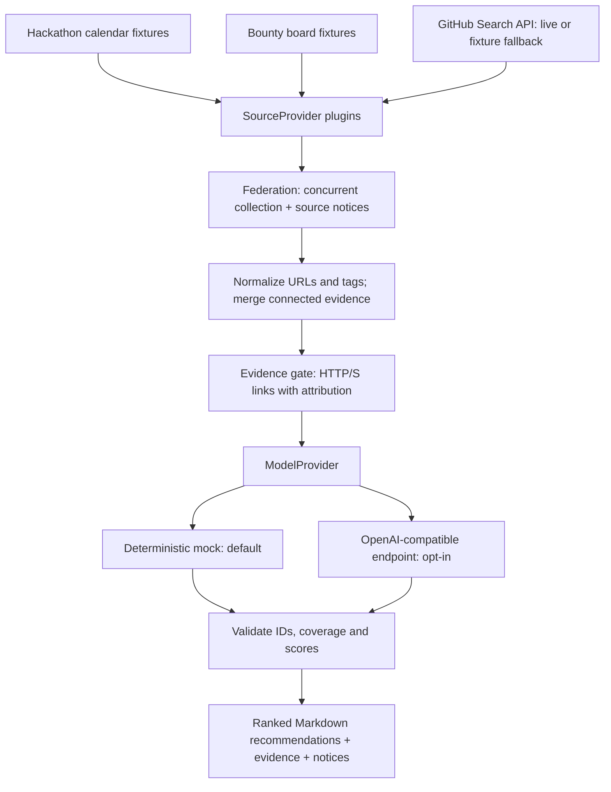

# Opportunity Radar

An evidence-first opportunity federation agent: combine fragmented hackathon calendars, bounty boards and GitHub issues into a single ranked Markdown brief.

Developers currently compare overlapping listings by hand. Radar keeps source attribution, merges duplicates, and ranks the resulting opportunities against a user profile. Every recommendation includes its evidence links. Records without valid HTTP(S) evidence never reach the model.

## Quickstart

Requires Node.js 22 and npm. From the repository root:

```bash
cd open-agent-hackathon-2026
npm ci
npx tsc --noEmit
npm test
npm run demo
```

The demo needs no API key and makes no network requests. It federates **8 synthetic records from 3 sources → 6 deduplicated records → 5 recommendations**, with one unlinked rumor excluded. All fixture URLs and opportunities are illustrative, not actual application leads. Repeated runs produce the same report. See [sample output](examples/offline-report.md).

```bash
npm run build
node dist/cli.js --profile "typescript agents data open-source"
node dist/cli.js --help
node dist/cli.js > report.md
```

## Architecture



- `src/sources/`: `SourceProvider` implementations. One provider failing does not discard healthy results. GitHub requests up to 20 recently updated open issues labeled `bounty`, without authentication, with a 10-second timeout. Rate limits, network failures and malformed payloads use clearly disclosed synthetic fixtures. Hackathon and bounty-board providers are fixtures in this version.
- `src/core/`: federation, URL normalization, connected-component deduplication and ranking. Tracking parameters and fragments are removed; identity query parameters remain. Shared canonical evidence merges records transitively, preserving each source attribution. Equal titles alone do not merge records, so some duplicates with no shared link remain separate. Scores sort descending, then by stable ID.
- `src/llm/`: interchangeable model providers. Mock scores reward exact profile/tag matches, evidence count and a deterministic hash tie break. External model output must include each eligible ID exactly once with a finite score in `[0,100]` and a nonempty explanation. Invalid model output fails the run; it is not silently replaced with mock output.
- `src/report/`: Markdown rendering with escaped source text, score explanations, provenance links and source notices. A link is evidence provenance, not confirmation of an offer, payment, eligibility or deadline.
- `src/test/`: tests using the built-in Node test runner, including CLI, pipeline, error paths and mocked HTTP adapters. `test/fixtures/`: versioned synthetic datasets.

No shell execution, evaluation of source content, or code generation is used in the application. Source descriptions are sent to the external model as untrusted JSON data, with instructions to ground explanations in the provided evidence. Structured validation limits unsupported IDs/scores; it cannot guarantee that natural-language model explanations are factually correct.

## Live GitHub and optional Nemotron / Meterless

GitHub alone works without credentials:

```bash
npm run live
# Equivalent after building:
node dist/cli.js --live --model mock
```

External ranking is separately opt-in. Use the exact API base URL, key and model identifier issued by your Meterless account (or another OpenAI-compatible service). Do not append `/chat/completions` to the base URL; the adapter does that. No unverified Meterless URL or model name is hardcoded.

```bash
cp .env.example .env
# Set variables in your shell or secret manager; Node does not auto-load .env.
node --env-file=.env dist/cli.js --live --model openai
```

| Variable | Purpose |
| --- | --- |
| `MODEL_BASE_URL` | API base URL, typically ending in `/v1` |
| `MODEL_API_KEY` | Bearer token for the configured model service |
| `MODEL_NAME` | Exact model identifier, e.g. your provisioned NVIDIA Nemotron model |

The adapter uses `POST {MODEL_BASE_URL}/chat/completions`, a 30-second timeout and JSON text responses. It deliberately does not require a vendor-specific SDK or JSON-schema response mode. Test it without live GitHub via `node --env-file=.env dist/cli.js --model openai`. External mode transmits eligible opportunity descriptions, evidence links and the profile to that endpoint. Keep `.env` out of Git; keys are not included in reports or HTTP error bodies.

Live mode mixes **live GitHub issues and synthetic calendar/board fixtures**; the report labels this clearly. The external model integration is covered by mocked contract tests; an actual Meterless/Nemotron call requires supplied credentials and has not been verified in this repository.

## Library and plugins

```typescript
import {
  federate, deduplicate, rankOpportunities, MockModelProvider,
  type SourceProvider, type Opportunity,
} from './dist/index.js';

const mySource: SourceProvider = {
  name: 'my-calendar',
  async fetch(): Promise<Opportunity[]> {
    return [{
      id: 'calendar:example', title: 'Example event', kind: 'hackathon',
      description: 'Replace with your source description.', tags: ['typescript'],
      evidence: [{ url: 'https://example.org/event', source: 'my-calendar' }],
    }];
  },
};
const collected = await federate([mySource]);
const recommendations = await rankOpportunities(
  deduplicate(collected.opportunities), new MockModelProvider(), 'typescript',
);
console.log(recommendations);
```

Custom sources return normalized `Opportunity` records and should retain stable IDs and primary evidence links. Custom models implement `ModelProvider.rank()`. Both interfaces are exported with TypeScript declarations. The fixture loader resolves data relative to the installed project, not the current working directory.

## Track fit and sponsor technology

For track 01, **Solving Fragmented Intelligence**, the core contribution is a complete path from three fragmented source types to one attributed recommendation list. Federation and evidence-connected deduplication preserve provenance rather than losing it in a plain text summary. The demo makes the consolidation and rejected rumor visible.

The OpenAI-compatible adapter provides an integration point for **NVIDIA Nemotron via Meterless**, once account-specific configuration is supplied. Meterless prompt-library integration is not implemented. The source interface is an extension point for a **Zetaris** federated view; this version does not connect to Zetaris or claim a completed sponsor integration. No Cursor integration or sponsor bonus is claimed. Hackathon dates, prizes and eligibility should be verified separately before submission.

See [DEMO.md](DEMO.md) for a concise walkthrough and reproducible validation commands.

## License

MIT, inherited from the repository root; a copy is included in this project.
